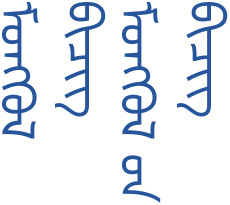

# mongol-unicode-renderer

An engine-independent Rust library for **Unicode Mongolian contextual shaping,
vertical word wrapping, and seamless CPU rendering**. Extracted and reworked
from a game-side renderer. This is a rendering library, not a new font.

[Design and API](docs/design.md) · [Third-party notices](THIRD_PARTY.md)



## Quick start

Rust 1.85+; no system font installation is needed. The only bundled font is an
**unmodified Noto Sans Mongolian** test fixture, redistributed with its copyright
notice and **SIL Open Font License 1.1**, not under the project's MIT license.

```sh
git clone https://github.com/romchina/mongol-unicode-renderer.git
cd mongol-unicode-renderer
cargo run --locked --example render -- tests/fonts/NotoSansMongolian-Regular.ttf output/demo.png
cargo run --locked --example render -- path/to/font.ttf output/custom.png --text "ᠮᠣᠩᠭᠣᠯ ᠪᠢᠴᠢᠭ" --size 32 --height 256
```

For UTF-8 files use `--text-file text.txt`. For pixel fonts use `--pixel` with
font-specific native-grid size multiples and integer output positions.
The PNG example defaults to a white background; `--transparent` keeps alpha.
The core library always returns transparent RGBA. The README specimen uses the
default sample text with `--size 48 --height 240`.

## Library usage

The library is not on crates.io yet; use a local path dependency or a pinned Git
revision rather than a moving branch:

```toml
[dependencies]
mongol-unicode-renderer = { path = "../mongol-unicode-renderer" }
```

```rust
use mongol_unicode_renderer::{Font, LayoutOptions, RasterOptions, render_layout};

fn main() -> Result<(), Box<dyn std::error::Error>> {
    let bytes = std::fs::read("tests/fonts/NotoSansMongolian-Regular.ttf")?;
    let font = Font::new(&bytes)?;
    let layout = font.layout("ᠮᠣᠩᠭᠣᠯ ᠪᠢᠴᠢᠭ", &LayoutOptions {
        font_size: 32.0,
        max_height: 256.0,
        ..Default::default()
    })?;
    let image = render_layout(&font, &layout, &RasterOptions::default())?;
    // Upload image.width / image.height / image.rgba to an engine or PNG encoder.
    Ok(())
}
```

## Pipeline

1. Shape a complete logical Mongolian run with HarfRust / OpenType (`mong`, `mn`, LTR).
2. Preserve FVS1–4, MVS, ZWJ, ZWNJ, NBSP, and NNBSP input for the font's shaper.
3. Measure actual positioned outlines, including overhangs and negative bearings.
4. Wrap whole words at ASCII spaces; keep NBSP/NNBSP suffix groups intact.
5. Map shaped coordinates to top-to-bottom ink, with columns ordered left-to-right.
6. Fill all glyph outlines in one path instead of independently rotated atlas cells.
7. Return straight-alpha RGBA8, ready for engine texture upload or PNG encoding.

Default rendering is smooth with whole-run 4x supersampling. Pixel mode disables
AA and rescaling. Missing glyphs, PUA input, overflow and invalid sizes are errors,
not silently corrupted output. `OverflowPolicy::Keep` explicitly preserves an
overlong word at its requested size and reports an overflow flag.

## Scope

Outline OpenType fonts, face 0, default font instance. Not a legacy Menksoft
converter, full bidi/Unicode line-breaking engine, font fallback system, or
mixed CJK/Latin vertical typesetter. Split mixed-script runs upstream. Bitmap,
color and SVG glyph rendering, variable-axis selection and advanced feature
configuration are not implemented. Font support determines which variation
sequences actually select distinct glyphs; accepting a selector is not a promise
that every font supports it.

ASCII edge/repeated spaces normalize; CRLF/CR normalize to LF. Explicit blank
paragraphs become blank columns. Words/selectors are never split and text is
never silently shrunk or clipped. Each input is limited to 64 KiB; raster/canvas
allocations are limited to 8192px per side and 16,777,216 pixels including
supersampling. These guards are not a complete sandbox for adversarial input.
Core WASM compilation is checked; there are no JS bindings or web UI yet.

## Development

```sh
python tools/check_font_policy.py
cargo fmt --all --check
cargo clippy --locked --all-targets -- -D warnings
cargo test --locked --all-targets
cargo test --locked --doc
rustup target add wasm32-unknown-unknown
cargo check --locked --lib --target wasm32-unknown-unknown
```

Native tests, doc-tests, PNG generation, and core WASM compilation run in CI.
Regression tests are not a complete Mongolian orthographic conformance suite.

## Licensing and font policy

- Project code: **MIT**, see [LICENSE](LICENSE).
- The Noto test font: **SIL OFL 1.1**, see [tests/fonts/OFL.txt](tests/fonts/OFL.txt).
  Its original copyright notice, pinned source, and checksums are retained in
  [tests/fonts/README.md](tests/fonts/README.md).
- The [OFL redistribution conditions](https://openfontlicense.org/open-font-license-official-text/)
  permit bundling with software when the copyright notice and license accompany
  the font. This fixture is unmodified and is not sold separately or relicensed.
- No font is embedded in the compiled library. Check your own font's embedding
  and distribution terms when integrating it.
- **No evaluation, commercial, game-specific, or other unapproved font files
  may be committed.** Font files are ignored by default; the pinned OFL Noto
  fixture is the sole exception. CI checks tracked font signatures, filenames,
  the fixture's SHA-256, and its accompanying license checksum.
- No game art, dialogue scripts, credentials, or private deployment configuration
  is included.
